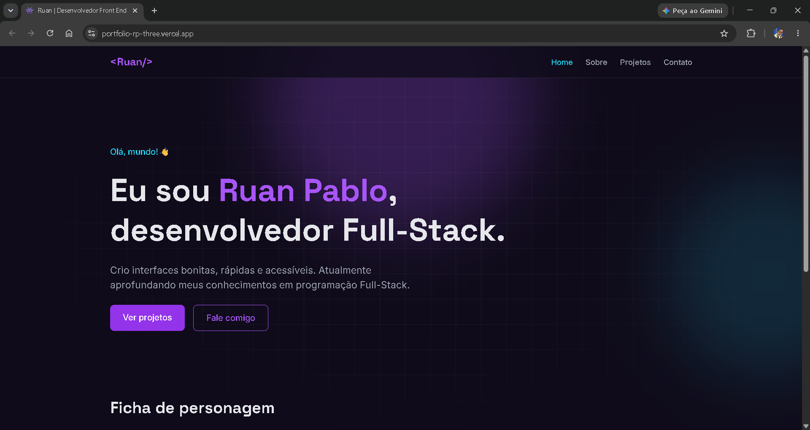

# 👾 Portfólio | Ruan Pablo

Portfólio pessoal de desenvolvedor Full-Stack: site responsivo e acessível,
com formulário de contato funcional.

🔗 **Demo:** https://portfolio-rp-three.vercel.app



## Funcionalidades

- Páginas: Home, Sobre, Projetos, Contato e 404 personalizada
- Layout responsivo, com menu hambúrguer no celular
- Formulário de contato real, com validação e estados de envio
- Animações com Motion, respeitando a preferência "reduzir movimento"
- Acessibilidade: navegação por teclado, skip link e contraste AA
- Lighthouse (produção): Performance 99 · Acessibilidade 100 · Boas práticas 100 · SEO 91

## Tecnologias

- [React](https://react.dev) + [Vite](https://vite.dev)
- [React Router](https://reactrouter.com)
- [Tailwind CSS](https://tailwindcss.com)
- [Motion](https://motion.dev)
- [Formspree](https://formspree.io) (envio do formulário)
- Deploy na [Vercel](https://vercel.com)

## Como rodar localmente

Pré-requisito: [Node.js](https://nodejs.org) (versão LTS).

```bash
git clone https://github.com/Rp-1177/portfolio-rp.git
cd portfolio-rp
npm install
copy .env.example .env.local   # no Mac/Linux: cp .env.example .env.local
npm run dev
```

Edite o `.env.local` e coloque o endereço do seu formulário do Formspree:

```
VITE_FORMSPREE_URL=https://formspree.io/f/SEU_ID
```

Outros comandos: `npm run build` (gera a versão de produção) e `npm run preview` (testa ela localmente).

## Estrutura

```
src/
├── components/   # peças reutilizáveis (Button, Card, Navbar...)
├── data/         # dados dos projetos
├── hooks/        # hooks personalizados
├── layouts/      # layout base das páginas
└── pages/        # uma página por arquivo
```

## Aprendizados

- Componentes reutilizáveis com variantes e props
- Acessibilidade na prática (WCAG AA, skip link, foco visível)
- Deploy contínuo e variáveis de ambiente
- Até certo ponto o formulário recarregava ao enviar, mesmo com o código aparentemente correto, depois de isolar o problema comconsole.log e com a aba Network, sem achar solução substituí o arquivo inteiro, depois passei a usar a comparação de arquivos do VS Code e o Auto Save, o que mostrou que um espaço vazio resultava no formulário recarregar a página

## Próximos passos

- [ ] Modo claro/escuro
- [ ] Imagem de prévia para compartilhamento de link

## Contato

[LinkedIn](https://linkedin.com/in/rp1177) · [GitHub](https://github.com/Rp-1177)